# Tailor — AI Resume Customizer

Paste a job description, upload your resume (PDF or DOCX), and get an **honest, ATS-friendly version tailored to the role** — streamed live, scored before and after, reviewable line by line, and downloadable as PDF, Word, Markdown or plain text. It also writes a matching cover letter.

**Live app:** https://resume-customizer-nu.vercel.app · **API docs:** https://resume-customizer-api-weqs.onrender.com/docs

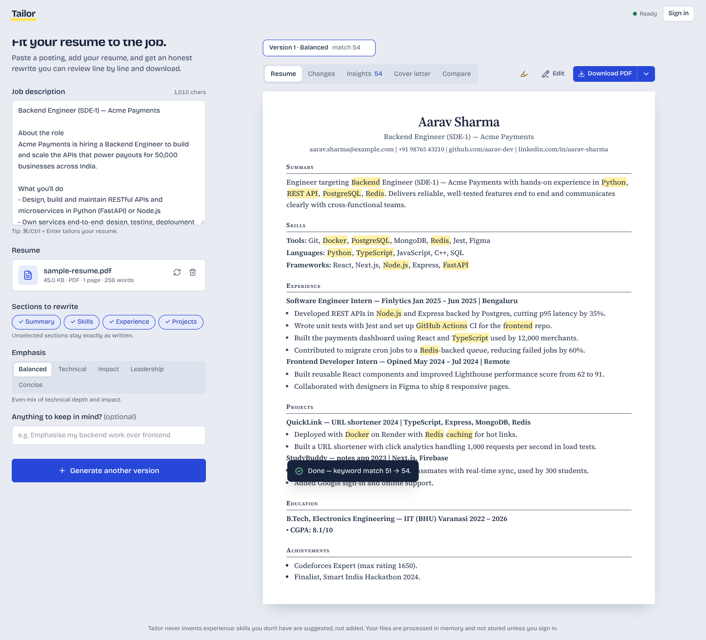

---

## Contents

- [Features](#features)
- [Tech stack](#tech-stack)
- [LLM provider & model](#llm-provider--model)
- [Architecture](#architecture)
- [How the tailoring works](#how-the-tailoring-works)
- [Run locally](#run-locally)
- [Deploy](#deploy)
- [API reference](#api-reference)
- [Evaluating the prompt](#evaluating-the-prompt)
- [Edge cases handled](#edge-cases-handled)
- [Testing](#testing)
- [Limitations & trade-offs](#limitations--trade-offs)
- [Screenshots](#screenshots)

---

## Features

### Core (all required features)

| Requirement | Implementation |
|---|---|
| JD input with validation | Paste or **import from a job-posting link**. Textarea with live character count; empty / < 100 chars / > 20,000 chars / "not actually a JD" are all rejected with specific messages (client **and** server). |
| Resume upload (PDF + DOCX + LaTeX) | Drag-and-drop or picker, upload progress bar, shows **file name, size, type, pages, word count and the detected template** (font, size, paper, margins), plus parse warnings. Text is extracted on the backend with `pdfplumber` / `python-docx` / a LaTeX-to-text reader. |
| LLM customization | Makes the **smallest edits that help**: orders skills by JD relevance, reorders bullets and tightens only the ones that gain from it (strong bullets stay verbatim), and lists missing keywords with honest suggestions. A summary is **opt-in** (off by default). |
| Output display | The tailored resume as a "sheet of paper" with JD keywords highlighted, plus a **PDF view** that renders the exact file you'll download (pdf.js, works on phones). |
| Download | **PDF**, **Word (.docx)**, **LaTeX (.tex)** with one-click **Open in Overleaf**, **Markdown**, **plain text**, copy to clipboard, and print. Exports are ATS-friendly (single column, real text, real bullet characters, no f-ligatures in LaTeX). |
| Error handling | Invalid/oversized/corrupt/encrypted/scanned files, empty inputs, LLM rate limits, timeouts, bad JSON, provider outages — every failure has a clear, actionable message. |

### Bonus (all eight implemented)

| Bonus | Implementation |
|---|---|
| ✅ **Match score** | Deterministic weighted keyword match (0–100) shown **before and after** tailoring, with the exact matched/missing keywords, **must-have coverage** ("7 of 9 must-haves"), and which skills are **shown in a bullet vs only listed** in Skills. |
| ✅ **Diff view** | "Changes" tab: **side-by-side** before/after with word-level marks (or inline) for the summary and every bullet, "moved up" indicators, per-section rationale — and **accept / revert each line**. Downloads respect your choices. |
| ✅ **Multiple versions** | Generate up to 6 versions with different emphasis (Balanced, Technical, Impact, Leadership, Concise) and **compare any two — or any version against your original** — line by line, side by side, or as full pages. Versions persist across page reloads. |
| ✅ **Section-wise customization** | Choose which of Skills / Experience / Projects to edit, and whether to include a summary. Unselected sections are restored **verbatim and in original order** by the server, even if the model ignores the instruction. |
| ✅ **Cover letter generator** | Streams a cover letter with selectable voice and length, optional hiring manager and company; editable, downloadable as PDF/DOCX/TXT. |
| ✅ **ATS score** | 100-point checklist across 9 checks (contact info, standard headings, keyword coverage, action verbs, quantified impact, bullet length, length, writing style, parseability), each with a concrete tip. Before and after. |
| ✅ **Authentication** | Email + password accounts (scrypt hashing, JWT). Signed-in users get every result saved to **History**, can reopen or delete it, and cover letters are attached to the saved run. |
| ✅ **Streaming response** | Server-Sent Events. The resume **renders progressively on the page as the model writes it** (partial-JSON parsing), with stage progress and a Stop button. |

### Beyond the brief

- **Truthfulness guardrails** — after the model responds, the server strips any skill the resume doesn't evidence (moving it to "missing keywords"), removes dates or locations that aren't in the original, and flags any rewritten bullet that introduces a number or technology not in the original ("Check: 90% isn't in your original resume"). The model *cannot* silently inflate a resume.
- **Ask AI (chat editor)** — ask for any change in plain words ("shorten the Acme bullets", "add a 2-line summary", "0.5 inch margins", "serif font"). The AI **proposes**; you see a before/after diff, the score change and any truthfulness flags, then **Apply** or **Discard** (with Undo). Proposals pass the same guardrails as tailoring.
- **Keeps your template** — *Match original* is the default after upload. **Word and LaTeX uploads are edited in place**: only the text of matched bullets, skills lines and (optionally) the summary changes, so fonts, spacing, tables and macros are untouched; LaTeX previews are compiled from your own source in a sandbox (Tectonic/pdfLaTeX, no file or shell access). **PDF uploads** have their fonts, sizes, margins, heading style, rules and colours detected and recreated. Switch to Classic / Compact / Serif any time.
- **Page setup** — paper size, margins (top/bottom/left/right, inches), font family and sizes, line spacing, heading case and rule, header alignment, accent colour, summary on/off and fit-to-one-page. Applied to the PDF view and every download; remembered between visits.
- **Extra material (optional)** — add another resume, project write-ups or role details (file or pasted text). They're used only as secondary evidence to enrich existing bullets and the summary — never copied in as new experience, and the guardrails accept facts from them.
- **Precise feedback** — must-haves x/y, nice-to-haves x/y, which section each keyword appears in, how many lines were kept / lightly edited / rewritten, and the next best fixes ranked by score impact.
- **ATS layout check of your actual file** — inspects the uploaded PDF's geometry or the DOCX's XML for what really breaks ATS parsing: two-column layouts, tables, text boxes, images, contact details in headers/footers and garbled icon-font glyphs, each with a fix.
- **Download read-back** — the tailored PDF is rendered and parsed back by the same parser used for uploads, proving every bullet, section and contact detail survives ("10/10 bullets, 5/5 sections recovered").
- **One-page fit** — if the PDF spills onto an extra page, it is re-rendered with a slightly tighter layout and the tighter version is kept when it saves a page.
- **"I have this" — honest gap closing** — every missing keyword has an *I have this* button with an optional note ("used Docker to deploy QuickLink"). Confirmed skills are fed to the next version and accepted by the guardrails as evidence, so a resume can truthfully improve beyond what the original text says.
- **Grounding check** — a rewrite that keeps less than 30% of its original bullet's content words is flagged as drifted ("make sure it's still accurate").
- **Copied-from-JD detector** — rewritten bullets that lift 8+ words verbatim from the job post are flagged; recruiters spot (and penalise) parroted JD language.
- **Import JD from a link** — reads the schema.org `JobPosting` data most job boards embed (Greenhouse, Lever, Workday, Naukri…), falls back to the page's main text, and refuses private/internal addresses (SSRF-safe, redirect-checked, size- and time-limited). Sign-in-walled pages (e.g. LinkedIn) get a clear "paste the text instead".
- **Local & private mode** — set `LLM_PROVIDERS=ollama` to run on a local model via [Ollama](https://ollama.com), no API key or data leaving the machine.
- **Job-board clean-up** — pasting a JD strips "Apply now", "Posted 3 days ago", EEO statements and duplicated lines (with Undo), so they don't waste tokens or add fake keywords.
- **Prompt evaluation harness** — `python -m evals.run_eval` runs the real model over four job descriptions and reports validity, score deltas, guardrail hits, style and keyword-stuffing metrics, with an optional LLM-as-judge grade. See [Evaluating the prompt](#evaluating-the-prompt).
- **Fit check before tailoring** — as soon as a JD and resume are present you see the baseline match and ATS scores (no LLM call needed).
- **Inline editing** — edit any line of the tailored resume directly; edits flow into every download.
- **Provider failover** — Gemini → Groq (→ OpenAI) chain with retries, exponential backoff and `Retry-After` support.
- **Cold-start aware UI** — detects a sleeping free-tier backend and tells the user it's waking up instead of failing.
- **Prompt-injection hardening** — JD and resume are fenced and declared as data; a JD saying "ignore previous instructions" is treated as text.
- **"Try a sample"** one-click demo, keyboard shortcut (⌘/Ctrl + Enter), dark mode, mobile layout, reduced-motion support, accessible focus states and ARIA roles.

---

## Tech stack

| Layer | Technology |
|---|---|
| Frontend | **Next.js 16 (App Router)**, React 19, TypeScript, Tailwind CSS v4, `lucide-react`, `diff` (word diffs), `partial-json` (progressive rendering of streamed JSON). Self-hosted fonts: Bricolage Grotesque + Source Serif 4. |
| Backend | **Python 3.13, FastAPI**, Pydantic v2, `httpx` (async LLM client), `pdfplumber`, `python-docx`, `reportlab` (PDF export), SQLAlchemy 2 (SQLite / Postgres), PyJWT. |
| LLM | Google **Gemini** (primary) with **Groq** fallback, via their OpenAI-compatible endpoints. |
| Hosting | Frontend on **Vercel**, backend on **Render** (Docker). |
| CI | GitHub Actions — backend tests, frontend typecheck + lint + build. |

## LLM provider & model

| Role | Provider | Model | Why |
|---|---|---|---|
| Primary | Google AI Studio (Gemini) | `gemini-3.8-flash` | Free tier, fast, strong instruction-following and long-context JSON output. `reasoning_effort=low` keeps latency down. |
| Fallback | Groq | `openai/gpt-oss-120b` | Free tier, very fast inference; takes over automatically on rate limits, 5xx or timeouts. |
| Optional | OpenAI | `gpt-4.1-mini` | Add `openai` to `LLM_PROVIDERS` if you have a key. |
| Local | Ollama | `llama3.1` (any pulled model) | Fully local and private; add `ollama` to `LLM_PROVIDERS`. |

All of these are called through **one** small `httpx` client because they share the OpenAI Chat Completions wire format — no vendor SDKs, easy to swap. Models are configurable via env vars. For development and tests there is also a deterministic `mock` provider (`LLM_PROVIDERS=mock`) so the full app runs without any API key.

---

## Architecture

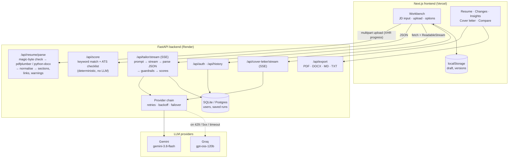

### Repository layout

```
.
├── backend/
│   ├── app/
│   │   ├── main.py                # app factory, CORS, error handling
│   │   ├── config.py              # env-driven settings
│   │   ├── api/                   # routes: resume, cover_letter, export, auth, history, SSE helpers
│   │   ├── core/                  # typed errors, rate limiter, password hashing + JWT
│   │   ├── models/                # Pydantic schemas, SQLAlchemy models
│   │   └── services/
│   │       ├── parsing.py         # PDF/DOCX extraction + normalisation
│   │       ├── prompts.py         # prompt engineering
│   │       ├── tailor.py          # pipeline + truthfulness guardrails
│   │       ├── keywords.py        # skills lexicon, JD keyword weighting, match score
│   │       ├── scoring.py         # ATS checklist
│   │       ├── render.py          # resume → text / markdown
│   │       ├── export.py          # PDF (reportlab) and DOCX (python-docx)
│   │       ├── latex.py           # LaTeX export (Overleaf-ready)
│   │       ├── jd.py              # job-board boilerplate clean-up
│   │       ├── jd_fetch.py        # import JD from URL (SSRF-safe, JSON-LD aware)
│   │       ├── layout_check.py    # file-level ATS checks (columns, tables, images, headers)
│   │       └── llm/               # OpenAI-compatible client, provider chain, mock
│   ├── evals/                     # prompt evaluation harness + sample JDs
│   ├── tests/                     # 106 pytest tests
│   ├── Dockerfile
│   └── .env.example
├── frontend/
│   ├── src/app/                   # layout, page, global styles/tokens
│   ├── src/components/            # Workbench, ResumePaper, ChangesView, InsightsView, …
│   ├── src/lib/                   # API client (SSE), types, partial-JSON, storage
│   └── .env.example
├── render.yaml                    # one-click Render blueprint for the API
└── .github/workflows/ci.yml
```

---

## How the tailoring works

1. **Clean.** Job-board boilerplate lines are dropped from the JD (only lines that are entirely boilerplate).
2. **Parse.** The upload is identified by magic bytes (not the extension), then text is extracted. Normalisation fixes ligatures (`fi`→`fi`), odd bullet glyphs and unmapped `(cid:N)` characters, hyphenated line breaks and wrapped bullet lines. Hidden hyperlinks (LinkedIn/GitHub behind text) are recovered from PDF annotations and DOCX relationships.
3. **Baseline score.** `keywords.py` extracts weighted JD keywords from a ~285-entry skills lexicon with aliases (`k8s`→Kubernetes, `Postgres`→PostgreSQL, `RESTful`→REST API) plus unusual acronyms (SOC2, HIPAA). Keywords in a "requirements / must have" context and repeated ones weigh more. The ATS checklist runs on the same text.
4. **Prompt.** The system prompt (in `services/prompts.py`) sets a recruiter persona, non-negotiable truthfulness rules, per-section instructions (summary length, XYZ bullet formula, action verbs), the selected sections and tone, and a strict JSON schema. Every rewritten unit carries its **verbatim original**, which powers the diff and the guardrails. The schema's key order follows the page's reading order so the UI can render progressively while streaming.
5. **Stream.** Tokens stream over SSE (with keep-alive pings so proxies don't cut idle connections). The frontend parses incomplete JSON on every frame and paints the resume as it's written.
6. **Validate & repair.** The final text is parsed tolerantly (code fences, prose, trailing commas). If it's still invalid, the server retries once in strict JSON mode at lower temperature.
7. **Guardrails.** Evidence = the resume **plus skills the user explicitly confirmed**. Locked sections are restored; unevidenced skills are removed and moved to suggestions; invented dates/locations are removed; bullets that introduce new numbers or tools, copy 8+ words from the JD, or drift too far from their original are flagged; "missing" keywords the resume actually has are dropped.
8. **Score again.** The same deterministic scorers run on the tailored resume, so the before/after comparison is apples-to-apples.

---

## Run locally

**Prerequisites:** Python 3.11+ (3.13 recommended), Node.js 20+ (22 recommended), and a free API key from [Google AI Studio](https://aistudio.google.com/apikey) and/or [Groq](https://console.groq.com/keys).

### 1. Backend

```bash
cd backend
python -m venv .venv
source .venv/bin/activate            # Windows: .venv\Scripts\activate
pip install -r requirements-dev.txt
cp .env.example .env                 # then add GEMINI_API_KEY and/or GROQ_API_KEY
uvicorn app.main:app --reload --port 8000
```

API docs: http://localhost:8000/docs · health: http://localhost:8000/api/health

> No key yet? Run with `LLM_PROVIDERS=mock` to try the whole app with a rule-based stand-in.

### 2. Frontend

```bash
cd frontend
npm install
cp .env.example .env.local           # NEXT_PUBLIC_API_URL=http://localhost:8000
npm run dev
```

Open http://localhost:3000 and click **Try it with a sample resume and job**.

### With Docker (backend only)

```bash
cd backend
docker build -t resume-customizer-api .
docker run -p 8000:8000 --env-file .env resume-customizer-api
```

---

## Deploy

### Backend → Render

1. Push this repo to GitHub.
2. In Render: **New → Blueprint**, pick the repo. `render.yaml` creates the `resume-customizer-api` web service from `backend/Dockerfile`.
3. Fill in the prompted secrets: `GEMINI_API_KEY`, `GROQ_API_KEY`, and `CORS_ORIGINS` (your Vercel URL, e.g. `https://tailor-resume.vercel.app`). Optionally `CORS_ORIGIN_REGEX` for preview deployments and `DATABASE_URL` for a Postgres database (e.g. [Neon](https://neon.tech) free tier) so accounts and history survive restarts.
4. Check `https://<service>.onrender.com/api/health`.
5. **Keep it awake (optional).** The free plan sleeps after ~15 idle minutes, and the next visitor waits ~30–60 s for a cold start. In GitHub, go to **Settings → Secrets and variables → Actions → Variables** and add `BACKEND_URL=https://<service>.onrender.com`. The `keep-alive` workflow then calls `/api/ping` every 10 minutes. An external monitor such as [UptimeRobot](https://uptimerobot.com) or [cron-job.org](https://cron-job.org) pointed at `/api/ping` works too and is more punctual than GitHub's scheduler.

### Frontend → Vercel

1. **Add New → Project**, import the repo, set **Root Directory** to `frontend`.
2. Add the env var `NEXT_PUBLIC_API_URL=https://<service>.onrender.com`.
3. Deploy, then make sure that URL is in the backend's `CORS_ORIGINS`.

On any non-localhost API URL the app shows a dismissible "hosted on a free plan" note, a start-up progress bar while the server wakes, and pings the backend every 10 minutes while a tab is open. Set `NEXT_PUBLIC_FREE_HOSTING=false` to turn this off on paid hosting.

---

## API reference

| Method | Path | Description |
|---|---|---|
| `GET` | `/api/health` | Status, configured LLM providers and input limits. |
| `GET` · `HEAD` | `/api/ping` | Cheap liveness check for uptime monitors and keep-alive pings (no database or AI call). |
| `POST` | `/api/resume/parse` | Multipart `file` (PDF/DOCX/TeX ≤ 5 MB) → text, metadata, sections, links, warnings, detected `style` and a `source_id` for template matching. |
| `POST` | `/api/documents/parse` | Multipart `file` (PDF/DOCX/TeX/TXT/MD) → text of a supporting document. |
| `POST` | `/api/chat` | `{message, history, resume, job_description, resume_text, layout, …}` → `{reply, changes, proposal: {result, layout, diff} \| null}`. Nothing is applied server-side. |
| `POST` | `/api/score` | `{job_description, resume_text}` → match + ATS scores (no LLM). |
| `POST` | `/api/jd/fetch` | `{url}` → job description imported from a job-posting page (title, company, cleaned text). |
| `POST` | `/api/jd/clean` | `{job_description}` → JD with job-board boilerplate removed + count. |
| `POST` | `/api/tailor` | Tailor and return JSON in one response. |
| `POST` | `/api/tailor/stream` | Same, as SSE: `status` → `delta`… → `result` (or `error`). |
| `POST` | `/api/cover-letter` · `/stream` | Generate a cover letter (JSON or SSE). |
| `POST` | `/api/export/check` | `{resume}` → render the PDF and parse it back: pages, sections/bullets/contact recovered. |
| `POST` | `/api/export` | `{format: pdf\|docx\|tex\|md\|txt, resume?, cover_letter?, layout?, source_id?, inline?}` → file (headers `X-Render-Mode`: `original-file` \| `style-match` \| `template`, and `X-Render-Note`). |
| `POST` | `/api/auth/register` · `/login` | `{email, password, name?}` → `{token, user}`. |
| `GET` | `/api/auth/me` | Current user. |
| `GET` · `DELETE` | `/api/history` · `/api/history/{id}` | List, open or delete saved runs. |
| `PUT` | `/api/history/{id}/cover-letter` | Attach a cover letter to a saved run. |

Tailor request body:

```json
{
  "job_description": "…",
  "resume_text": "…",
  "sections": ["skills", "experience", "projects"],
  "tone": "balanced | technical | impact | leadership | concise",
  "extra_instructions": "optional, ≤ 500 chars",
  "confirmed_skills": [{"keyword": "Kubernetes", "context": "deployed QuickLink on k3s"}],
  "supporting_documents": [{"label": "QuickLink notes", "text": "…"}],
  "resume_filename": "optional"
}
```

Errors always look like `{"error": {"code": "jd_too_short", "message": "…human readable…"}}` with an appropriate HTTP status (413, 415, 422, 429, 502, 503…).

---

## Evaluating the prompt

Prompt quality is 20% of the brief, so it's measured rather than eyeballed. With a real API key in `backend/.env`:

```bash
cd backend
python -m evals.run_eval              # 4 JDs (backend, frontend, data, ML) × the sample resume
python -m evals.run_eval --judge      # + LLM-as-judge grades for truthfulness, relevance, readability
python -m evals.run_eval --resume ~/my_resume.pdf --tone impact
```

It writes `evals/report.md` with one row per JD:

| Metric | What it catches | Target |
|---|---|---|
| `valid_first_try` | Model broke the JSON schema and needed the repair call | True |
| `match_before → after`, `ats_before → after` | Whether tailoring actually helps (same deterministic scorer) | ↑ |
| `skills_stripped`, `bullets_flagged`, `details_removed` | Hallucinated skills, numbers, tools, dates — caught by guardrails | 0 |
| `summary_words`, `action_verb_pct`, `avg_bullet_words` | Prompt's style rules followed | 45–70, ≥ 85%, ≤ 30 |
| `flag_types` | Which guardrails fired (number, skill, copied, drift) — read those bullets | ideally `-` |
| `max_keyword_repeats` | Keyword stuffing | ≤ 3 |

Change the prompt in `app/services/prompts.py`, rerun, compare reports.

---

## Edge cases handled

**Files:** empty file · > 5 MB (checked while streaming the upload, not after) · images, `.txt`, renamed files (magic-byte detection) · legacy `.doc` · password-protected PDF and DOCX · corrupted PDF/DOCX · scanned image-only PDF (explains OCR isn't supported) · > 10 pages · too little text · very long resumes (truncated with a warning) · multi-column/table layouts in DOCX · headers/footers · unmapped glyphs and ligatures · Unicode names in exports and download filenames.

**Inputs:** empty / too short / too long JD · job-board boilerplate in pasted JDs · JD links that are private/internal addresses, unusual ports, redirect loops, sign-in walls, non-HTML, oversized or JavaScript-only pages · text that isn't a job description (heuristic + model check) · non-resume uploads (warning) · zero sections selected · prompt injection inside the JD or resume.

**LLM:** missing API keys (clear 503) · invalid key · rate limits (Retry-After, then failover) · 5xx · timeouts · empty responses · non-JSON or truncated JSON (tolerant parse + strict-mode retry) · `null` fields and invalid enums (coerced) · unsupported request params (dropped and retried) · connection dropped mid-stream · hallucinated skills, numbers, tools, dates and locations (guardrails) · LaTeX special characters (`& % $ # _ { } ~ ^ \`) in exports.

**App:** sleeping free-tier backend (wake-up banner + retries) · network errors · user cancels generation · expired login tokens · other users' history (404) · per-IP rate limiting · CORS on error responses · page refresh mid-session (draft, resume and versions restored).

---

## Testing

```bash
cd backend && python -m pytest       # 106 tests
cd frontend && npx tsc --noEmit && npm run lint && npm run build
```

The backend suite covers parsing edge cases (generated PDFs/DOCX, encrypted, scanned, corrupt), keyword matching false positives (`go`, `rest`, `excel`, `C` vs `C++`), the ATS checklist, every guardrail, JSON repair, provider failover, SSE streaming, exports (including a round-trip: exported PDF → parser → bullets intact), auth and history isolation, rate limiting and CORS. The full UI flow was also exercised end-to-end in headless Chromium (upload → stream → diff → insights → versions → compare → cover letter → edit → history, plus error states, mobile and dark mode) with no console errors.

---

## Limitations & trade-offs

- **Scanned PDFs** aren't OCR'd — the user is asked for a text-based PDF or DOCX. OCR (e.g. Tesseract) would add a heavy system dependency to a free-tier container.
- **Multi-column PDFs** may extract in a mixed reading order. The LLM copes well, but the "as read" preview can look jumbled.
- **Match/ATS scores are heuristics.** They're deterministic and explainable by design, but no public scorer matches every commercial ATS. The skills lexicon is tech-focused; non-tech JDs get fewer tracked keywords.
- **The score gain is deliberately modest.** Because the app refuses to add skills you don't have, a resume missing Kubernetes stays missing Kubernetes — the gap is shown as suggestions instead.
- **Free hosting:** Render's free tier sleeps after inactivity (the UI explains the ~30–60 s wake-up). With the default SQLite, accounts/history reset on redeploy; set `DATABASE_URL` to Postgres to persist them.
- **Rate limiting is in-memory** (per instance). Use Redis if you scale horizontally.
- **Auth is intentionally basic:** JWT in `localStorage`, no email verification or password reset. Fine for a demo; production would use httpOnly cookies and a proper identity provider.
- **PDF originals are recreated, not edited.** A PDF can't be edited reliably, so its style is detected and recreated (fonts are mapped to sans/serif). Word and LaTeX originals are edited in place. The PDF preview of a Word original is a close style match — the Word download is the exact file.
- **Uploaded originals are kept for 48 hours** (so downloads can reuse the template), then deleted automatically. LaTeX compiles are sandboxed; a file that needs disallowed features (`\\input` of other files, shell escape…) falls back to a style match.
- **Streaming JSON** means the live preview occasionally shows a partially written field for a moment before it completes — the final result is always validated server-side.

---

## Screenshots

| | |
|---|---|
| **Ask AI: propose → apply** 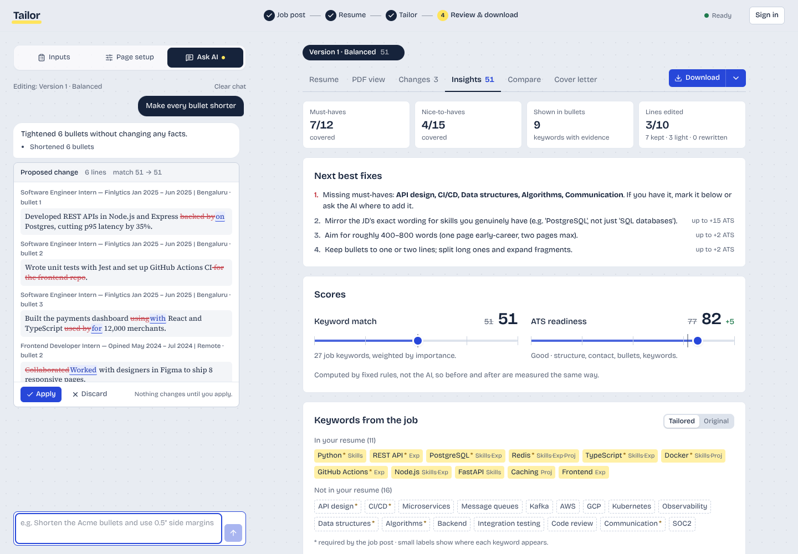 | **PDF view in your own LaTeX template** 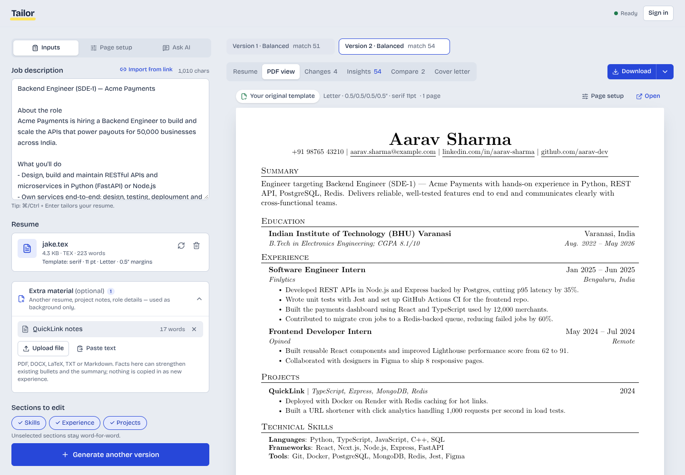 |
| **Page setup & template matching** 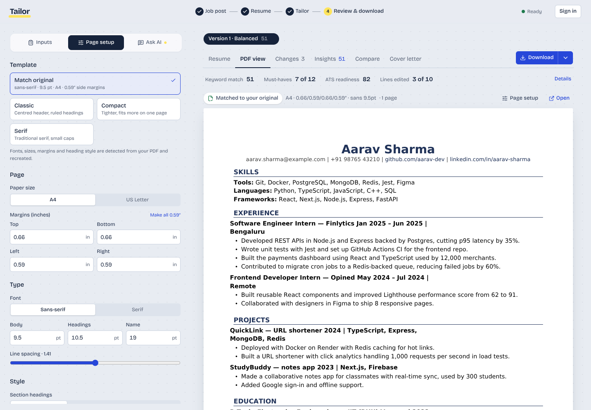 | **Side-by-side changes, accept/revert** 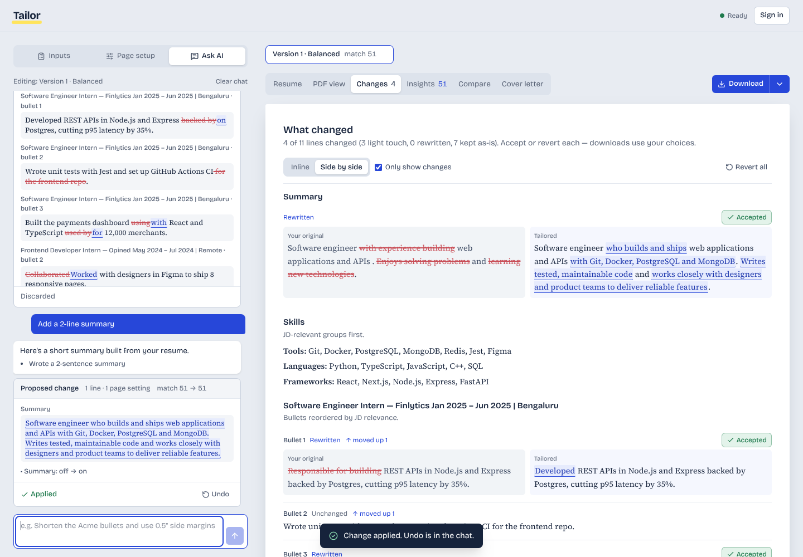 |
| **Live streaming** 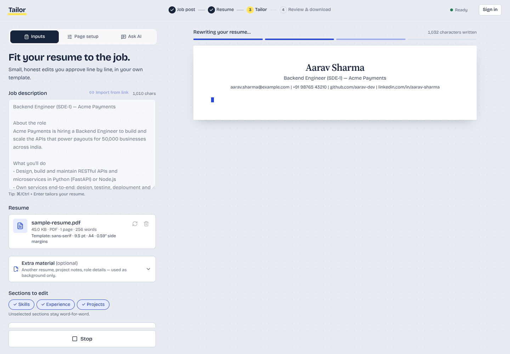 | **Compare versions (or vs original)** 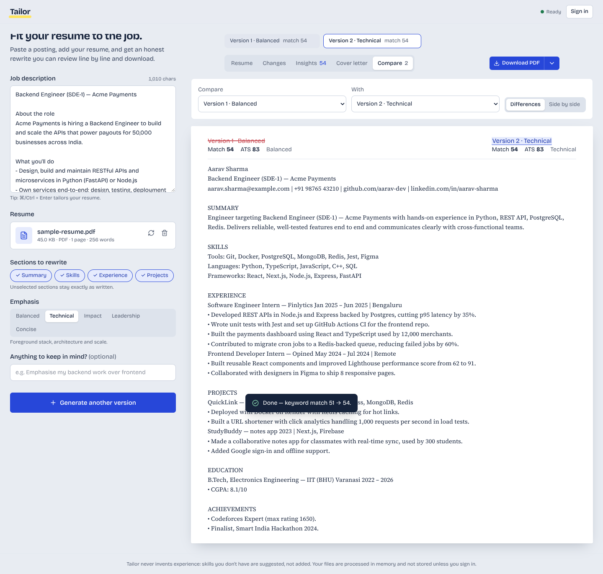 |
| **Match & ATS insights** 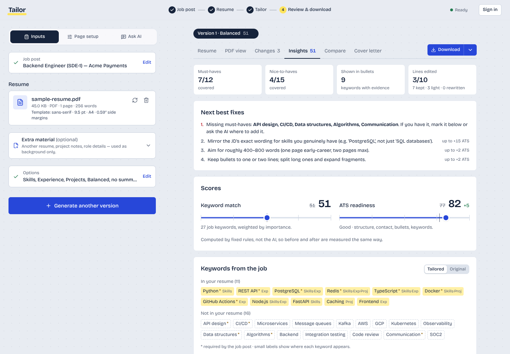 | **Empty state** 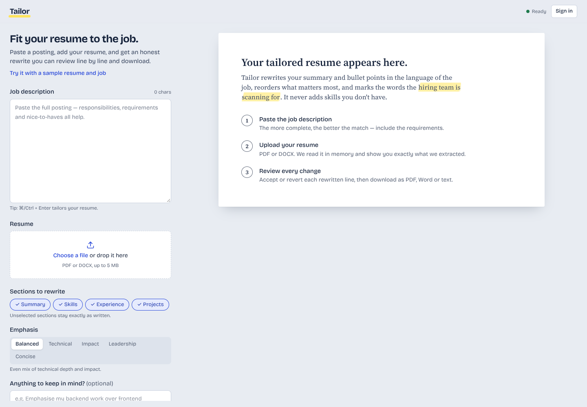 |
| **Cover letter** 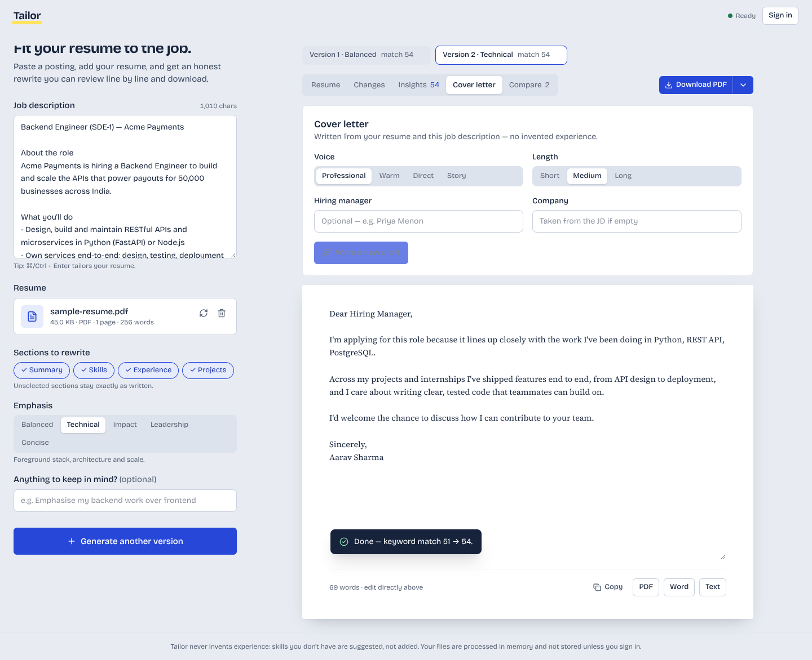 | **Dark mode** 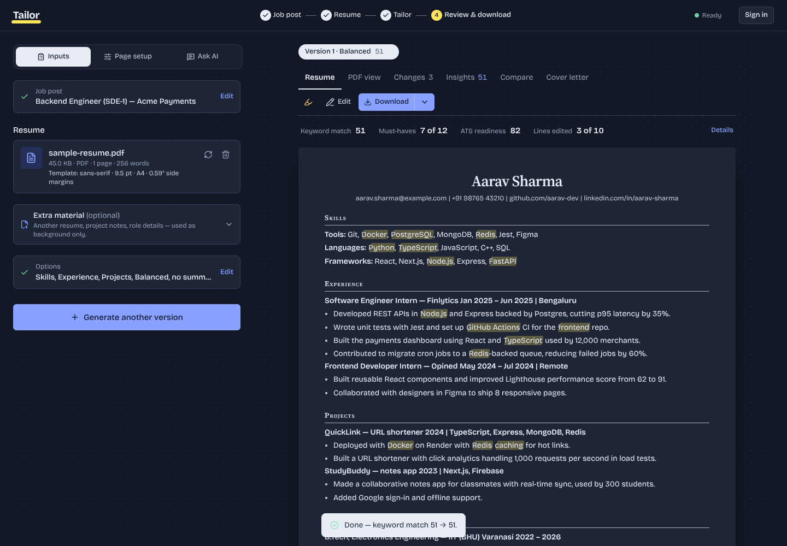 |
| **Mobile** 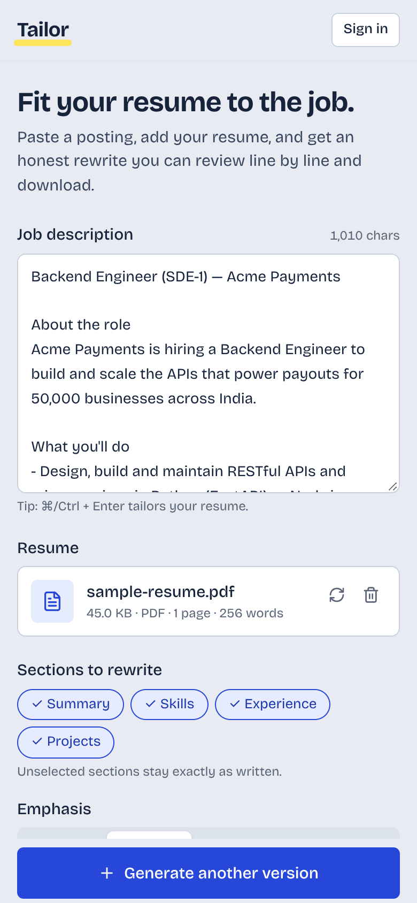 | |
